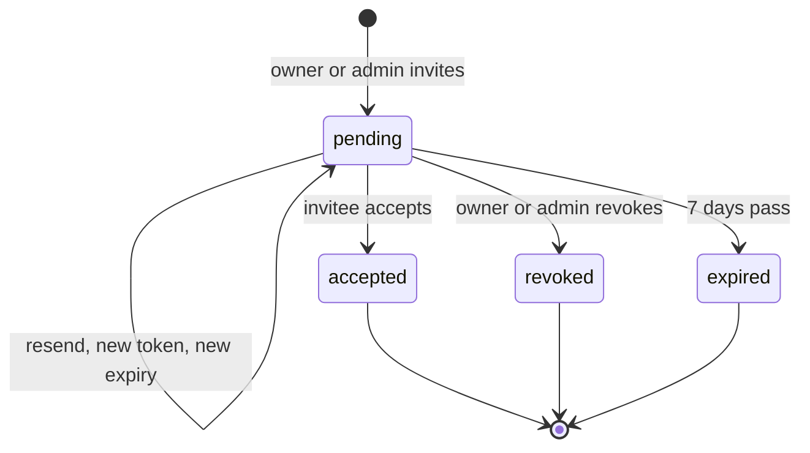
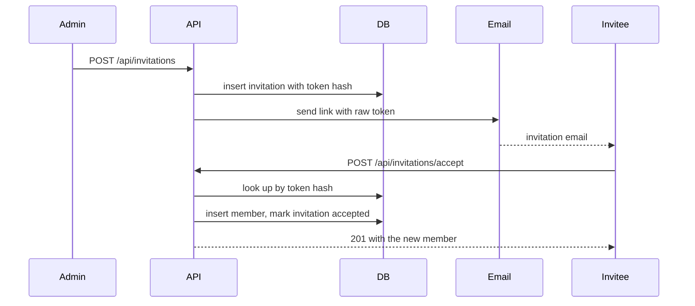

# Invitations design notes

Owners and admins invite teammates by email. The person invited does not have an account yet, so the invitation link is the only thing that proves they were invited.

## Lifecycle

An invitation starts as pending. It ends in one of three states.

| State | How it gets there |
| --- | --- |
| Accepted | The invitee opens the link before it expires and picks a name |
| Revoked | An owner or admin cancels it |
| Expired | Seven days pass without it being accepted |

## Accepting an invitation

## Decisions

**Tokens are hashed at rest.** Only the SHA-256 hash of each token is stored. Someone with a copy of the database cannot use it to join the workspace.

**Resending issues a new token.** The old link stops working the moment a new one is sent, so a forwarded email cannot be used after a resend. Each invitation can be resent three times.

**One pending invitation per email.** A partial unique index enforces this in the database, so two admins clicking invite at the same moment cannot create duplicates.

**Admins cannot create owners.** Owners can assign any role. Admins can assign any role except owner. This matches the rule for changing an existing member's role.

**Every change is audited.** Role changes, removals and each step of an invitation are written to the audit log, which owners and admins can read.

## Open questions

- Should expired invitations be deleted after 90 days, or kept for the audit trail?
- Do we need a per-workspace limit on pending invitations to stop abuse?
